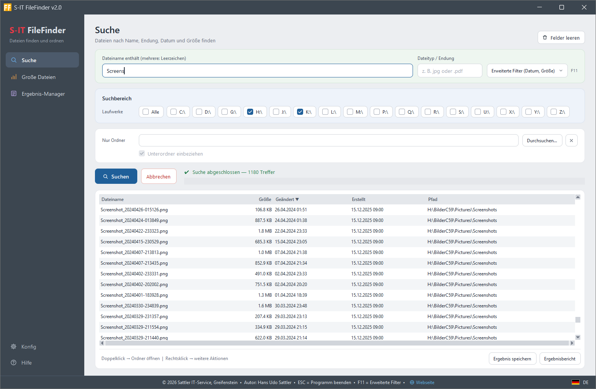
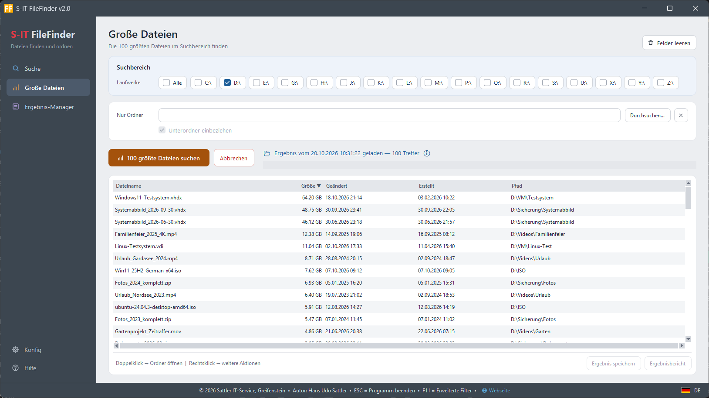

🇬🇧 [This page in English](README.md)

# 🔍 S-IT FileFinder

**Version 2.0 · Freeware · Windows 10 / 11 · 18 Sprachen**

Ein schnelles, übersichtliches Suchwerkzeug für Windows – für alle, die in verstreuten Datenbeständen den Überblick brauchen, wo was liegt.



---

## Für wen ist dieses Tool?

Für alle, die in einem Wust von Daten Klarheit brauchen: Dateien, die über mehrere Laufwerke und Ordner verstreut liegen, findet S-IT FileFinder schnell und zeigt sie mit Pfad, Größe und Datum in einer sortierbaren Liste. Von dort lassen sich die verstreuten Dateien gesammelt an einem Ort zusammenführen.

Die klare Struktur der Oberfläche macht das Tool zugleich für Anwender leicht bedienbar, die wenig Erfahrung mit Suchprogrammen haben.

**S-IT FileFinder bietet:**

- **Schnelle Suche über mehrere Laufwerke** oder gezielt in einem einzelnen Ordner
- **Suche nach Namensbruchstücken** – auch wenn nur ein Teil des Dateinamens bekannt ist
- **Datum und Dateigröße eingrenzen** – ohne Syntaxkenntnisse
- **Verstreute Dateien zusammenführen** – Treffer markieren und gesammelt kopieren oder verschieben
- **Klare, beschriftete Eingabefelder** – kein Raten, was wohin gehört
- **Ergebnisse speichern** – später wieder laden oder als HTML-Bericht weitergeben

---

## Oberfläche

Links steht eine Seitenleiste mit **Suche**, **Große Dateien**, **Ergebnis-Manager**, **Konfig** und **Hilfe**. Rechts daneben liegen Suchkriterien, Laufwerke und Ordner in eigenen, farblich abgesetzten Kästen, darunter die Trefferliste. **„Felder leeren“** oben rechts setzt die Ansicht zurück.

Fünf Farbschemata stehen zur Wahl: Standard, Weich-Hell, Gedämpft (Vorgabe), Stärker gedämpft und Dunkel.

---

## Funktionen

### Suchkriterien

| Feld | Beschreibung |
|---|---|
| **Dateiname enthält** | Ein oder mehrere Bruchstücke, durch Leerzeichen getrennt (UND-Verknüpfung) |
| **Dateityp / Endung** | z. B. `jpg`, `.pdf`, `docx` – mit oder ohne Punkt |
| **Erstellt von / bis** | Datum im Format `TT.MM.JJJJ` |
| **Geändert von / bis** | Datum im Format `TT.MM.JJJJ` |
| **Größe mind. / höchstens** | In Megabyte – beide Felder optional |

Alle Felder sind optional und frei kombinierbar. Die erweiterten Filter für Datum und Größe lassen sich mit **F11** ein- und ausklappen.

### Suchbereich

Alle erkannten Laufwerke (lokal und eingebundene Netzlaufwerke) erscheinen automatisch als Häkchen; mit **„Alle“** werden sie auf einmal an- oder abgehakt. Alternativ wird über das Feld **„Nur Ordner“** gezielt ein einzelner Ordner durchsucht – die Laufwerksauswahl ist währenddessen deaktiviert und kehrt beim Leeren des Feldes zurück.

Mit **„Unterordner einbeziehen“** wird festgelegt, ob auch die Unterordner durchsucht werden oder nur die Dateien direkt im Ordner. Liegt die gesuchte Datei direkt in diesem Ordner, ist die Suche so deutlich schneller fertig.

### Trefferliste

- **Klick auf die Spaltenüberschrift** → sortieren nach Name, Größe, Datum oder Pfad (nach echtem Wert, nicht nach angezeigtem Text)
- **Doppelklick** → Ordner im Explorer öffnen, Datei markiert
- **Rechtsklick** → Kontextmenü: Ordner öffnen, Datei öffnen, Pfad kopieren, Dateiaktionen

### Große Dateien

Eine eigene Ansicht in der Seitenleiste zeigt auf Knopfdruck die 100 größten Dateien der gewählten Laufwerke oder des gewählten Ordners – zum schnellen Aufspüren von Speicherfressern. Die Ansicht hat ihre eigene Trefferliste; die Treffer der normalen Suche bleiben beim Wechsel erhalten.



### Dateiaktionen

Mehrere Treffer markieren und in einem eigenen Fenster **kopieren, verschieben oder in den Papierkorb legen** – mit Byte-genauem Fortschrittsbalken und ohne Überschreiben (bei Namensgleichheit wird automatisch umbenannt).

### Ergebnisse speichern & Ergebnis-Manager

Suchergebnisse speichern, später wieder laden oder als **HTML-Bericht** ansehen – Dateinamen und Pfade sind dort direkt anklickbar. Verwaltet wird alles im Ergebnis-Manager; gespeicherte Suchen lassen sich einzeln oder nach Zeitraum löschen.

### Konfiguration

Zentraler Dialog für Darstellungsgröße (90–200 %), erweiterte Filter beim Start, Standard-Sortierung, Sprache und Farbschema. Die eingestellte Darstellungsgröße gilt unabhängig von der Skalierung in Windows. Die Einstellungen stehen in `Config\FileFinder-config.ini`.

---

## Sprachen

Das Programm spricht 18 Sprachen: **Deutsch, Englisch, Französisch, Spanisch, Italienisch, Niederländisch, Polnisch, Dänisch, Kroatisch, Bosnisch, Serbisch, Montenegrinisch, Slowenisch, Albanisch, Rumänisch, Türkisch, Bulgarisch und Mazedonisch.** Die Sprache wird in der Konfiguration über ein Auswahlfenster gewählt; nach einer kurzen Rückfrage startet FileFinder in der gewählten Sprache neu. Übersetzt sind die Oberfläche, alle Meldungen, der Ergebnis-Manager, das Fenster für Dateiaktionen und der HTML-Ergebnisbericht.

Die Hilfe gibt es in vier Sprachen; bei allen übrigen Sprachen öffnet das Programm die englische Fassung:

- 🇩🇪 [Hilfe & Dokumentation](https://sattlerit.github.io/S-IT-FileFinder/S-IT-FileFinder-Hilfe.html)
- 🇬🇧 [Help & documentation](https://sattlerit.github.io/S-IT-FileFinder/S-IT-FileFinder-Help.html)
- 🇫🇷 [Aide & documentation](https://sattlerit.github.io/S-IT-FileFinder/S-IT-FileFinder-Aide.html)
- 🇪🇸 [Ayuda y documentación](https://sattlerit.github.io/S-IT-FileFinder/S-IT-FileFinder-Ayuda.html)

Änderungsverlauf: 🇩🇪 [Deutsch](https://sattlerit.github.io/S-IT-FileFinder/S-IT-FileFinder-Changelog.html) · 🇬🇧 [English](https://sattlerit.github.io/S-IT-FileFinder/S-IT-FileFinder-Changelog-en.html)

Dateinamen bleiben in jeder Sprache gleich – gespeicherte Suchen und Einstellungen bleiben nach einem Sprachwechsel unverändert erhalten.

---

## Download & Installation

Die aktuelle Version steht auf der **[Releases-Seite](../../releases)** bereit: `s-it-filefinder_latest.zip`.

Keine Installation notwendig: ZIP entpacken, den Ordner an einen beliebigen Ort legen und `S-IT-FileFinder.exe` starten. Der Programmordner sieht so aus:

```
S-IT-FileFinder\
├── S-IT-FileFinder.exe
├── _internal\        Laufzeitdateien
├── Lang\             Sprachpakete
├── Help\             Hilfe und Änderungsverlauf
├── License\          Lizenz und Haftungsausschluss
└── Config\           Einstellungen (wird beim ersten Speichern angelegt)
```

Die Unterordner gehören zum Programm und müssen bei der EXE bleiben. Die Hilfe wird über **„Hilfe“** in der Seitenleiste geöffnet – in der eingestellten Sprache.

---

## Technische Hinweise

- Darstellungsgröße 90–200 %, unabhängig von der Windows-Skalierung; das Fenster bleibt oberhalb der Taskleiste
- Die Suche läuft im Hintergrund, das Fenster bleibt jederzeit bedienbar
- Windows-Systemordner (`Windows`, `$Recycle.Bin` u. a.) werden im Wurzelverzeichnis der Laufwerke übersprungen – Suchen über das Systemlaufwerk laufen dadurch deutlich schneller
- Gesperrte Ordner werden übersprungen, die Anzahl erscheint in der Statuszeile
- Keine Administratorrechte erforderlich

---

## Unterstützung / Spende

S-IT FileFinder ist kostenlos und ohne Einschränkungen nutzbar.
Wer das Tool nützlich findet, darf mich gern über PayPal unterstützen:

**[tool-entwicklung@sattler-it.de](mailto:tool-entwicklung@sattler-it.de)**

---

## Weitere Tools

Weitere beliebte Freeware-Tools von Sattler IT-Service:

- **[S-IT-3Kopier](https://sattlerit.github.io/sit-3kopier/)** – Dreifach-Kopierer mit Protokoll und Zeitsteuerung, ebenfalls mehrsprachig
- **[S-IT LAN Device Scanner](https://www.wintotal.de/download/s-it-lan-device-scanner/)** – Netzwerkgeräte scannen, identifizieren und dokumentieren
- **[Tool-Übersicht](https://sattlerit.github.io/sattlerit-tools/)** – alle Tools auf einen Blick

---

## Lizenz

© 2026 Sattler IT-Service, Greifenstein
Autor: Hans Udo Sattler

Freeware – kostenlose Nutzung und Weitergabe erlaubt.
Kommerzielle Weiterverwendung oder Modifikation ohne Genehmigung nicht gestattet.
